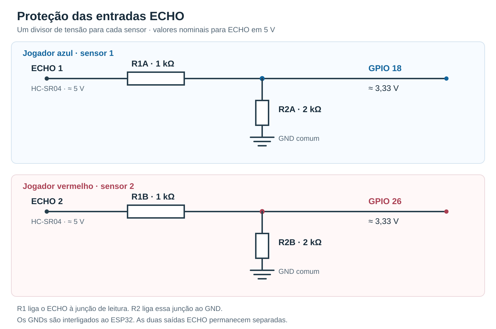

# ESP32 Arcade — Duelo de Goleiros

Um jogo de futebol inspirado no Pong, controlado pelo movimento das mãos. Dois jogadores usam sensores ultrassônicos para mover seus goleiros e defender a bola em uma tela compartilhada. O ESP32 faz as leituras, cria a rede Wi-Fi e hospeda a interface que roda no navegador.

O projeto foi desenvolvido para apresentação na disciplina **ACEX 1**, do **Bacharelado em Sistemas de Informação (BSI) do Instituto Federal da Bahia — campus Vitória da Conquista**, durante os **dois dias do evento “IFBA de Portas Abertas”**. O evento busca incentivar estudantes que estão concluindo o ensino médio a conhecer os cursos superiores e as possibilidades de ingresso na instituição.

A proposta foi apresentar conceitos de programação, eletrônica e comunicação em rede por meio de uma atividade que os visitantes pudessem experimentar: aproximar ou afastar a mão do sensor para disputar uma partida.

## Conteúdo

- [Como funciona](#como-funciona)
- [Materiais](#materiais)
- [Circuito eletrônico](#circuito-eletrônico)
- [Posicionamento dos sensores](#posicionamento-dos-sensores)
- [Instalação](#instalação)
- [Calibração e controles](#calibração-e-controles)
- [Ajustes do projeto](#ajustes-do-projeto)
- [Demonstração sem sensores](#demonstração-sem-sensores)
- [Organização do código](#organização-do-código)
- [Testes e limitações](#testes-e-limitações)
- [Solução de problemas](#solução-de-problemas)
- [Referências](#referências)

## Como funciona

O jogador azul controla o goleiro inferior; o vermelho controla o superior. Cada mão fica diante de um HC-SR04. A distância medida é convertida em uma posição horizontal dentro do campo, considerando os limites calibrados para aquele jogador.

A bola rebate nas laterais e nos goleiros. O ponto de contato com o goleiro altera a direção do rebote, e a velocidade aumenta ao longo das defesas. Quando a bola ultrapassa um dos goleiros, o adversário marca um gol. A configuração inicial encerra a partida aos **7 gols**.

O ESP32 envia as leituras por WebSocket. O navegador executa a física, atualiza o placar e desenha a partida com Canvas 2D, sobre uma imagem de campo armazenada no LittleFS. Depois de instalar os arquivos, o jogo funciona sem acesso à internet.

**A partida é disputada em uma tela compartilhada.** Abrir a página em outro dispositivo cria uma simulação independente: o ESP32 ainda não mantém um estado único de partida para sincronizar várias telas.

### Recursos

- Dois sensores e controles independentes.
- Interface adaptada a celular e computador.
- Calibração de distância mínima e máxima para cada jogador.
- Inversão do sentido de movimento.
- Resposta direta ou suavização com sensibilidade de 1 a 10.
- Indicadores de leitura, frequência e conexão.
- Reconexão automática do WebSocket.
- Envio dos arquivos da interface pelo próprio navegador.
- Modo de demonstração sem sensores.

Se um sensor perder o eco, seu goleiro conserva a última posição. A bola e a contagem de gols continuam. O mesmo vale para uma perda temporária da conexão da página com o ESP32.

## Materiais

| Quantidade | Componente | Aplicação |
|---|---|---|
| 1 | ESP32 DevKit V1, com ESP32 clássico | Leitura dos sensores, Wi-Fi e servidor |
| 2 | HC-SR04 | Medição da distância das mãos |
| 2 | Resistor de **1 kΩ** | Parte superior dos divisores de tensão |
| 2 | Resistor de **2 kΩ** | Parte inferior dos divisores de tensão |
| 1 | Cabo USB com transmissão de dados | Alimentação e gravação da placa |
| Conforme a montagem | Protoboard e jumpers | Conexões do circuito |
| 1 | Celular ou computador com navegador | Exibição da partida |

Os quatro resistores formam **dois divisores separados**, um para cada saída ECHO. Resistores de 1/4 W atendem com folga à dissipação desse circuito; prefira tolerância de 1% para reduzir a variação da relação de divisão.

## Circuito eletrônico

### Alimentação e referência comum

Os HC-SR04 são alimentados em **5 V**. Os sinais do ESP32 operam com lógica de **3,3 V**. A alimentação dos sensores e o nível de tensão dos GPIOs têm funções diferentes: alimentar o módulo em 5 V não autoriza aplicar essa tensão diretamente às entradas do microcontrolador.

Conecte os dois VCC dos sensores ao barramento de 5 V da montagem e todos os GNDs ao mesmo barramento de terra, incluindo o GND do ESP32. Essa referência comum é necessária para que os níveis dos sinais sejam interpretados corretamente.

Na DevKit, confira a identificação e a função do pino `5V` ou `VIN` na versão da placa utilizada. O pino `3V3` não é o ponto de alimentação previsto para os HC-SR04 deste circuito. Faça as conexões com a alimentação desligada.

### Ligações dos sensores

| Jogador | Pino do HC-SR04 | Conexão |
|---|---|---|
| Azul — sensor 1 | VCC | 5 V |
| Azul — sensor 1 | GND | GND comum |
| Azul — sensor 1 | TRIG | GPIO **5** |
| Azul — sensor 1 | ECHO | Entrada do divisor 1; saída do divisor no GPIO **18** |
| Vermelho — sensor 2 | VCC | 5 V |
| Vermelho — sensor 2 | GND | GND comum |
| Vermelho — sensor 2 | TRIG | GPIO **25** |
| Vermelho — sensor 2 | ECHO | Entrada do divisor 2; saída do divisor no GPIO **26** |

Os números acima são os **números dos GPIOs**, e não a posição física dos contatos na fileira da placa. Use as marcações da sua DevKit como referência.

### Por que usar os divisores de tensão

O ECHO do HC-SR04 alimentado em 5 V deve ser tratado como um sinal de 5 V. Os GPIOs do ESP32 não são tolerantes a esse nível. Cada divisor reduz a tensão que chega à entrada, mantendo a informação de duração do pulso.



Para montar **cada** divisor:

1. Ligue o ECHO do sensor a um resistor de **1 kΩ**, chamado de `R1`.
2. Ligue a outra ponta de `R1` ao GPIO de leitura: **18** no azul ou **26** no vermelho.
3. Desse mesmo ponto, ligue um resistor de **2 kΩ**, chamado de `R2`, até o GND comum.

O GPIO deve ficar na **junção entre os dois resistores**. As saídas ECHO dos dois módulos não devem ser unidas.

A tensão na junção é calculada por:

$$
V_{GPIO} = V_{ECHO} \times \frac{R_2}{R_1 + R_2}
$$

Com os valores utilizados:

$$
V_{GPIO} = 5\,V \times \frac{2\,k\Omega}{1\,k\Omega + 2\,k\Omega}
\approx 3{,}33\,V
$$

Esse é um resultado **nominal**: a tensão real depende da alimentação e da tolerância dos resistores. Antes de ligar o sinal ao ESP32, confira os valores e a montagem do divisor. A redução é feita nos dois ECHOs; apenas colocar um resistor em série não produz a mesma divisão.

### O que cada pino faz

| GPIO | Configuração no firmware | Função |
|---|---|---|
| **5** | Saída digital | Disparo do sensor azul |
| **18** | Entrada digital com interrupção | Medição da duração do ECHO azul, após o divisor |
| **25** | Saída digital | Disparo do sensor vermelho |
| **26** | Entrada digital com interrupção | Medição da duração do ECHO vermelho, após o divisor |

O TRIG recebe um pulso para iniciar a medição. O sensor emite ultrassom e responde pelo ECHO. A distância é obtida pelo tempo de ida e volta do som; por isso, o resultado inclui uma divisão por dois:

$$
d = \frac{t \times v_{som}}{2}
$$

No código, com tempo em microssegundos e distância em centímetros:

```cpp
const float cm = us * 0.0343f * 0.5f;
```

Os GPIOs 18 e 26 leem a **largura de um pulso digital**. Não é feita leitura analógica da tensão para determinar a distância.

O GPIO 5 também é um pino de *strapping*, cujo nível é considerado durante o reset do ESP32. A conexão ao TRIG deve preservar as condições de inicialização da placa. Para remapear os sinais, altere os vetores no início do firmware e ajuste a fiação correspondente:

```cpp
static const uint8_t TRIG[2] = {5, 25};
static const uint8_t ECHO[2] = {18, 26};
```

A primeira posição de cada vetor pertence ao azul; a segunda, ao vermelho.

## Posicionamento dos sensores

Fixe os sensores sobre a mesa, apontados horizontalmente para as mãos, com a palma voltada para o respectivo módulo. Evite que os dois sensores fiquem de frente um para o outro ou compartilhem a mesma área de reflexão.

A faixa inicial do controle é de **10 a 30 cm**. Ela pode ser alterada pela calibração, dentro do intervalo de **3 a 65 cm** aceito pelo firmware, com amplitude mínima de **6 cm**. Esses limites pertencem ao projeto e não representam todo o alcance nominal do HC-SR04.

Teste uma mão por vez antes de jogar com os dois sensores. Se uma leitura mudar ao movimentar somente a mão do outro jogador, revise a orientação dos módulos e os objetos refletores próximos.

## Instalação

### Preparar o Arduino IDE

1. Instale o [Arduino IDE 2](https://www.arduino.cc/en/software).
2. Em **Arquivo → Preferências → URLs adicionais para Gerenciadores de Placas**, adicione:

   ```text
   https://espressif.github.io/arduino-esp32/package_esp32_index.json
   ```

3. No **Gerenciador de Placas**, instale **esp32 by Espressif Systems**.
4. Para a placa de referência, selecione **DOIT ESP32 DEVKIT V1** e a porta COM correspondente.
5. No **Gerenciador de Bibliotecas**, instale **WebSockets**, de **Markus Sattler / Links2004**.

| Dependência | Origem |
|---|---|
| `WiFi.h` | Pacote de placas ESP32 |
| `WebServer.h` | Pacote de placas ESP32 |
| `LittleFS.h` | Pacote de placas ESP32 |
| `esp_timer.h` | ESP-IDF incluído no core ESP32 |
| `WebSocketsServer.h` | Biblioteca WebSockets de Markus Sattler |
| `SensorUltrassonico.h` | Arquivo deste repositório |

Não é necessário instalar uma biblioteca específica para o HC-SR04. A geração do TRIG e a captura do ECHO são feitas pelo firmware.

Se a placa não aparecer na lista de portas, confira o cabo USB e o driver do conversor USB–serial. Placas com CP2102/CP210x usam o [driver VCP da Silicon Labs](https://www.silabs.com/software-and-tools/usb-to-uart-bridge-vcp-drivers).

### Gravar o firmware

1. Mantenha `ESP32_Arcade_Duelo.ino` e `SensorUltrassonico.h` juntos na pasta **ESP32_Arcade_Duelo**.
2. Abra o `.ino` no Arduino IDE.
3. Use uma configuração de partições com espaço para filesystem, adequada ao tamanho da flash da sua placa. Em placas que oferecem essa opção, o rótulo da partição pode mencionar SPIFFS, embora o firmware use LittleFS.
4. Compile e envie o programa para o ESP32.
5. Abra o Monitor Serial em **115200 baud** para acompanhar a inicialização.

Registre as versões do core ESP32 e da WebSockets utilizadas na montagem para facilitar a reprodução do ambiente.

### Instalar a interface no LittleFS

O firmware inclui uma página de upload, dispensando um plugin adicional de filesystem na IDE.

1. Conecte o celular ou computador à rede criada pela placa:

   | Configuração | Valor padrão |
   |---|---|
   | Rede Wi-Fi | `ESP32-Duelo` |
   | Senha | `esp32duelo` |
   | Jogo | [http://192.168.4.1](http://192.168.4.1) |
   | Upload | [http://192.168.4.1/upload](http://192.168.4.1/upload) |
   | WebSocket | Porta `81` |

2. Abra a página `/upload`.
3. Selecione os quatro arquivos da pasta `data`: **index.html**, **style.css**, **game.js** e **campo.png**.
4. Aguarde a confirmação dos quatro envios e abra a página do jogo.

O sistema pode informar que o Wi-Fi está sem internet; essa rede é local. O uploader aceita somente os quatro nomes previstos e usa um arquivo temporário antes de substituir cada arquivo anterior. O limite é de 600 KiB por arquivo, com necessidade de espaço livre para o temporário.

O firmware utiliza `LittleFS.begin(true)`: uma falha ao montar o filesystem permite sua formatação. Nesse caso, os arquivos de `data` precisam ser enviados novamente.

Alterações apenas na interface podem ser enviadas pelo `/upload`. Mudanças no `.ino` ou no cabeçalho exigem uma nova gravação do firmware. As credenciais padrão podem ser alteradas em `AP_NOME` e `AP_SENHA`; a página de upload fica acessível aos dispositivos conectados à rede da placa.

## Calibração e controles

Abra **Calibração e direção** no cartão do jogador, posicione a mão no limite próximo e use **Capturar perto**. Depois afaste a mão até o limite desejado e use **Capturar longe**. Feche o painel para jogar.

Cada faixa precisa ter pelo menos 6 cm. Para deslocá-la inteiramente para distâncias maiores, capture primeiro o limite longe; para distâncias menores, capture primeiro o perto. Essa ordem evita que a validação dos limites impeça o ajuste.

**Inverter esquerda/direita** troca o sentido do movimento. A calibração e a inversão são salvas separadamente para cada jogador no navegador utilizado.

### Resposta direta e sensibilidade

**Resposta direta** vem ativada. A última distância aceita define a posição do goleiro no próximo quadro, sem suavização visual. Enquanto essa opção estiver marcada, o slider de sensibilidade aparece desabilitado.

Ao desmarcá-la, o slider passa a controlar a suavização: valores menores produzem um acompanhamento mais gradual; valores maiores respondem mais rapidamente. A calibração define a amplitude do movimento físico, enquanto a sensibilidade define como a posição acompanha esse movimento.

A preferência de modo também fica salva por jogador. Os cartões mostram a taxa observada de leituras aceitas e o tempo desde o último eco; esses indicadores ajudam no ajuste, mas não medem toda a latência entre a mão e a tela.

Abrir um painel de calibração ou ocultar a aba suspende a simulação. A perda de eco ou de Wi-Fi, por si só, não pausa a partida.

## Ajustes do projeto

### Velocidade da bola e pontuação

As configurações estão em `data/game.js`:

| Ajuste | Trecho | Valor padrão |
|---|---|---|
| Pontuação para vencer | `MAX_PONTOS`, no início do arquivo | `7` |
| Velocidade inicial e após um gol | `const v`, na função `servir` | `195` |
| Velocidade máxima após as defesas | Primeiro argumento de `Math.min`, em `rebatida` | `420` |
| Aumento proporcional por defesa | Multiplicador em `rebatida` | `1.035` |
| Aumento adicional por defesa | Parcela somada em `rebatida` | `3` |

As velocidades usam coordenadas do canvas por segundo. Para alterar a pontuação, mude somente `MAX_PONTOS`; `MIN_FAIXA` pertence à calibração. Atualize também o número mostrado no placar de `data/index.html`.

### Cadência das leituras

Em `SensorUltrassonico.h`:

```cpp
static const bool MODO_RAPIDO = true;
static const uint32_t INTERVALO_DISPAROS_US = MODO_RAPIDO ? 8000 : 65000;
static const bool FILTRAR_SALTOS = true;
static const bool LOG_SENSORES = false;
```

O modo rápido agenda disparos alternados a cada **8 ms**, com alvo nominal de **16 ms por jogador**. Trata-se de uma configuração experimental: a recomendação do HC-SR04 é usar ciclos acima de 60 ms. A frequência efetiva depende do módulo, da montagem e da quantidade de ecos válidos.

Se houver leituras cruzadas, `MODO_RAPIDO = false` usa 65 ms entre disparos. Também é possível comparar valores intermediários, como 12000 ou 16000 µs no modo rápido. Os dois sensores não são acionados simultaneamente.

`FILTRAR_SALTOS` exige confirmação para uma mudança muito grande, sem aplicar uma mediana contínua às leituras normais. `LOG_SENSORES` habilita a impressão periódica das distâncias na serial; por padrão, essas mensagens ficam desativadas.

O TRIG é encerrado por `esp_timer`, e as bordas do ECHO são capturadas por interrupção. O firmware do projeto não chama `delay()`, `delayMicroseconds()` ou `pulseIn()`. Ainda assim, medição acústica, rede, bibliotecas e renderização consomem tempo; o intervalo configurado não equivale à latência total do controle.

## Demonstração sem sensores

Na rede do ESP32, abra [http://192.168.4.1/?demo=1](http://192.168.4.1/?demo=1). Os sliders do simulador representam as distâncias das mãos.

Para executar a interface no computador, com Python 3 instalado, rode na pasta do projeto:

```bash
python -m http.server 8000 --directory data
```

Depois, acesse [http://localhost:8000/?demo=1](http://localhost:8000/?demo=1). A demonstração permite testar as regras e os controles da página, sem validar o circuito ou os sensores reais.

## Organização do código

| Caminho | Responsabilidade |
|---|---|
| `ESP32_Arcade_Duelo.ino` | Rede, HTTP, WebSocket, acionamento dos sensores e upload |
| `SensorUltrassonico.h` | Parâmetros de leitura, estruturas de captura e filtro |
| `data/index.html` | Estrutura da interface |
| `data/style.css` | Estilos e adaptação a diferentes telas |
| `data/game.js` | Controles, calibração, conexão, física e pontuação |
| `data/campo.png` | Imagem de fundo da arena |
| `docs/divisores-de-tensao.svg` | Esquema dos dois divisores de tensão |
| `docs/testes.md` | Procedimentos e limites da validação |
| `tests/` | Testes de lógica executados no computador |

## Testes e limitações

Os **25 testes JavaScript** e os testes C++ nativos com interfaces Arduino simuladas passaram na versão incluída neste repositório. Eles cobrem controles, reconexão, perda de leitura, colisões, pontuação, filtro, temporização e falhas de upload.

Na simulação temporal de um segundo, foram aceitos 62 ecos por jogador no modo rápido. Esse resultado verifica o agendamento do código; não comprova a mesma taxa acústica em todos os HC-SR04.

A compilação para a placa, o comportamento das interrupções e do timer sob carga de Wi-Fi, a estabilidade elétrica e a latência física precisam ser conferidos na montagem utilizada. As versões exatas do core e da biblioteca também devem acompanhar esse registro.

Os comandos dos testes e um roteiro de verificação estão em [docs/testes.md](docs/testes.md).

## Solução de problemas

| Sintoma | O que conferir |
|---|---|
| Nenhuma porta COM aparece | Cabo USB com dados, conexão da placa e driver do conversor USB–serial |
| `WebSocketsServer.h` não encontrado | Instalação da WebSockets de Markus Sattler, pelo Gerenciador de Bibliotecas |
| `SensorUltrassonico.h` não encontrado | Cabeçalho na mesma pasta do `.ino` |
| Campo ou página não carregam | Envio dos quatro arquivos de `data` e partição com espaço para LittleFS |
| Página abre, mas indica falta de conexão | Rede correta, acesso pelo IP da placa e comunicação WebSocket na porta 81 |
| Sensor indica ausência de eco | Alimentação, GND comum, TRIG/ECHO, divisor e direção da palma |
| Goleiro não alcança as extremidades | Limites perto/longe e amplitude de calibração |
| Slider de sensibilidade está desabilitado | Resposta direta está marcada; desmarque para usar suavização |
| Leitura salta ao usar os dois sensores | Separação das áreas de eco e teste com cadência mais conservadora |
| Alteração da interface não aparece | Reenvio do arquivo correto e recarregamento da página |

## Referências

- [HC-SR04 — datasheet da ElecFreaks](https://www.elecfreaks.com/download/HC-SR04.pdf).
- [ESP32 — datasheet da Espressif](https://documentation.espressif.com/esp32_datasheet_en.html).
- [ESP32-WROOM-32 — características elétricas e definição dos pinos](https://documentation.espressif.com/esp32-wroom-32_datasheet_en.html).
- [Instalação do Arduino-ESP32](https://docs.espressif.com/projects/arduino-esp32/en/latest/installing.html).
- [esp_timer — documentação do ESP-IDF](https://docs.espressif.com/projects/esp-idf/en/v4.4/esp32/api-reference/system/esp_timer.html).
- [WebSockets — Links2004 / Markus Sattler](https://github.com/Links2004/arduinoWebSockets).
